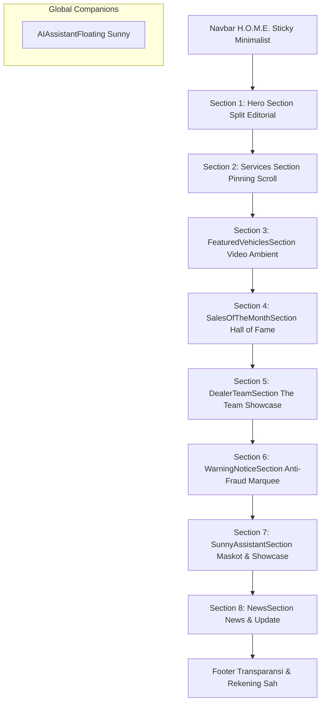

# DESIGN.md: Sistem Desain & Arsitektur Visual “Dealer Transparan” (Dealer Sunny)

> **Acuan Dokumen:** [`Master_PRD.md`](file:///c:/xampp/htdocs/OldSunny/Master_PRD.md)  
> **Tagline:** *Dealer Transparan, Layanan Tanpa Henti*  
> **Arah Visual:** Modern Editorial Luxury × Radical Corporate Transparency (Swiss Typographic Punch × Authentic Automotive Trust)  
> **Target Pengguna:** Calon pembeli kendaraan resmi, pelanggan servis purnajual, serta publik yang mengutamakan verifikasi keaslian dan proteksi anti-penipuan.

---

## 1. Filosofi & Arah Artistik (Art Direction)

1. **Editorial Modern Luxury & Clean Light Aesthetic:**  
   Menghindari gradasi ungu/pink generik AI dan tidak menggunakan emoji berlebihan. Desain mengusung tema terang (*light theme*) yang bersih, berwibawa, dan elegan, dipadukan dengan aksen warna primer dealer resmi: Slate Gelap, Emas/Kuning Kehormatan, dan Merah Presisi.
2. **Swiss Poster Display & Typographic Authority:**  
   Pemanfaatan tipografi berskala raksasa (*giant typography*) yang tegas dan berani (*ultra-bold 900+*), seperti running loop marquee pada section peringatan dan headline editorial pada showcase tim.
3. **Tactile Authenticity & Micro-Interactions:**  
   Setiap kartu dan elemen interaktif memiliki umpan balik visual nyata: sapuan kilau hologram (*hologram sheen foil*) pada kartu trading sales, bukaan shutter kamera mekanik (*GSAP slide shutter*), hingga pop-up kursor melayang (*interactive cursor HUD*).
4. **Transparansi Tanpa Kompromi (Anti-Fraud First):**  
   Kredibilitas diperlakukan sebagai fitur utama. Verifikasi staf aktif disajikan dengan badge kehormatan dan data terukur (NPS, CSI, dan ulasan riil), sementara edukasi anti-oknum dan direktori personel nonaktif disajikan dengan visibilitas tinggi demi keamanan finansial konsumen.

---

## 2. Palet Warna & Token Desain (Color Tokens)

Sistem warna dikalibrasi untuk kontras tinggi (memenuhi standar WCAG AA minimal 4.5:1 untuk teks biasa dan 3:1 untuk teks display).

```css
:root {
  /* Surface & Backgrounds */
  --bg-page: #F8F9FA;            /* Kanvas Dasar Bersih */
  --bg-surface: #FFFFFF;         /* Kartu Putih Bersih */
  --bg-cream-hero: #FAF5EE;      /* Warm Cream Eksklusif (Kartu Champion Rank 1) */
  --bg-dark-card: #111827;       /* Dark Obsidian Slate (Kartu Inverted Rank 2) */
  --bg-subtle: #F1F5F9;          /* Slate Lembut untuk Container/Input */

  /* Primary Brand & Typography */
  --text-primary: #0F172A;       /* Deep Slate Black (Keterbacaan Maksimal) */
  --text-secondary: #475569;     /* Slate Netral untuk Copy dan Deskripsi */
  --text-muted: #94A3B8;         /* Muted Slate untuk Label dan Metadata */
  --text-inverse: #FFFFFF;       /* Teks Putih Kontras */

  /* Dealership Core Accents */
  --accent-red: #E3000C;         /* Merah Presisi Dealer & Security Warning */
  --accent-red-hover: #C5000A;
  --accent-red-subtle: rgba(227, 0, 12, 0.12);

  --accent-yellow: #FDC700;      /* Kuning Emas Kehormatan (NPS & Rank 1) */
  --accent-yellow-gold: #F59E0B;
  --accent-yellow-subtle: rgba(253, 199, 0, 0.18);

  /* Status & Verification */
  --status-verified: #10B981;    /* Hijau Emerald Staf Aktif & Rekening Resmi */
  --status-verified-subtle: rgba(16, 185, 129, 0.12);
  --status-inactive: #E3000C;    /* Merah Personel Nonaktif / Resign */

  /* Border & Elevation */
  --border-subtle: rgba(0, 0, 0, 0.06);
  --border-medium: rgba(0, 0, 0, 0.12);
  --border-dark: #0F172A;
  --border-glass: rgba(255, 255, 255, 0.16);

  /* Shadows */
  --shadow-sm: 0 4px 12px rgba(15, 23, 42, 0.05);
  --shadow-md: 0 10px 30px -5px rgba(15, 23, 42, 0.08);
  --shadow-lg: 0 28px 60px -12px rgba(15, 23, 42, 0.22);
  --shadow-glass: 0 24px 50px -12px rgba(0, 0, 0, 0.55);
}
```

---

## 3. Sistem Tipografi (Typography Hierarchy)

Kombinasi font sans-serif modern berbobot tinggi untuk headline display korporat dan font netral bergeometri rapi untuk data teknis:

| Kategori | Font Family | Bobot (*Weight*) | Karakter & Kegunaan |
|---|---|---|---|
| **Display & Headline Utama** | `Plus Jakarta Sans`, `Outfit`, sans-serif | 800, 900, 950 | Teks masif marquee WARNING, judul Hero, The Team, dan nama varian |
| **Body & Konten Naratif** | `Inter`, `Plus Jakarta Sans`, sans-serif | 400, 500, 600 | Deskripsi layanan, klausul perlindungan, manifesto, dan body copy |
| **Identitas & Angka Metrik** | `Plus Jakarta Sans`, monospace | 700, 800 | Skor NPS (`+96`), Indeks CSI (`99.4`), Peringkat (`01`, `02`), tahun |
| **Data Teknis & Kode Staf** | `JetBrains Mono`, `Consolas`, monospace | 600, 700 | NIK resmi karyawan (`SNY-SLS-0412`), kode rekening BCA, kode metadata |

### Skala Ukuran Tipografi:
- **Giant Marquee Text:** `clamp(4.5rem, 14vw, 12rem)` / Line-height: `0.8` / Tracking: `-0.04em`
- **Hero Title (`h1`):** `clamp(2.5rem, 5.5vw, 4.25rem)` / Line-height: `1.08` / Weight: `850`
- **Section Heading (`h2`):** `clamp(2rem, 4vw, 3.25rem)` / Line-height: `1.15` / Weight: `800`
- **Card Heading (`h3`):** `clamp(1.25rem, 2vw, 1.75rem)` / Line-height: `1.2` / Weight: `700`
- **Body Large / Lead:** `1.125rem` (18px) / Line-height: `1.6` / Weight: `400`
- **Body Standard:** `0.95rem` – `1rem` (15–16px) / Line-height: `1.6`
- **Badge / Micro-label:** `0.72rem` – `0.78rem` (11–12px) / Tracking: `0.06em` / Uppercase

---

## 4. Arsitektur Struktur Halaman (Landing Page Experience Flow)

Halaman utama ([Home.jsx](file:///c:/xampp/htdocs/OldSunny/src/pages/Home.jsx)) disusun secara linear dengan alur narasi konversi dan pembuktian kredibilitas:



### 4.1 Section 1: Hero Section & Navbar H.O.M.E.
- **Navbar Minimalis:** Desain ramping menempel di bagian atas (*sticky*) dengan navigasi empat pilar **H.O.M.E.** (*History, Operations, Models, Ethics*), status layanan aktif, dan tombol panggilan darurat.
- **Split Hero Layout:**
  - Sisi kiri: Tipografi judul editorial, pernyataan komitmen transparansi tanpa mark-up tersembunyi.
  - Tiga tombol aksi instan persona:
    1. *Booking Servis / Darurat Purnajual* (Aksen Merah Cepat)
    2. *Eksplorasi Varian Mobil* (Aksen Gelap)
    3. *Verifikasi Legalitas & Struktur Dealer* (Aksen Netral)
  - Sisi kanan: Visual unit hero dinamis dengan micro-card jaminan garansi resmi.

### 4.2 Section 2: Services Section (Jelajah Layanan)
- **Mekanika GSAP ScrollTrigger Pinning:** Section melakukan *pinning* horizontal/vertikal bertahap saat digulir (*scrub scroll*).
- **Layanan Inti:** Perawatan Berkala Standar Pabrikan, Suku Cadang Orisinal Bersertifikat, Perbaikan Bodi & Cat Presisi, serta Layanan Derek Darurat 24/7 (SOS).

### 4.3 Section 3: FeaturedVehiclesSection (3 Varian Utama)
- **Latar Belakang Video Ambient:** Mengintegrasikan video latar belakang bersuara bisu (*muted autoplay video* `url_6acb321e18d7d3.92845255.mp4`) berulang halus (*loop*) dengan lapisan gradasi transparan gelap untuk menjaga keterbacaan teks.
- **Tiga Varian Unggulan:**
  1. *NEW XFORCE* (Rp 388.000.000)
  2. *DESTINATOR* (Rp 402.000.000)
  3. *PAJERO SPORT PRO* (Rp 612.000.000)
- **Fitur Interaktif:** Modal formulir uji jalan (*test drive booking*) lengkap dengan pemilihan tanggal, syarat uji kemudi, dan spesifikasi unit resmi.

### 4.4 Section 4: SalesOfTheMonthSection (Hall of Fame Pelayanan)
- **Filosofi Ranking Kepuasan:** Peringkat konsultan penjualan disusun murni berdasarkan skor Net Promoter Score (NPS), indeks kepuasan CSI, dan lama pengabdian (*tenure*), bukan sekadar angka penjualan unit.
- **Tata Letak Kartu Trading (Kiri ke Kanan):**
  - **Peringkat 1 (Paling Kiri):** Rian Ardiansyah (Senior Sales Executive) – Palet Warm Cream Hero (`#FAF5EE`), lencana emas `01`, `Since 2020`, `+96 NPS`. Foto di atas, teks di bawah.
  - **Peringkat 2 (Tengah - Inverted Card):** Dewi Sartika (Sales Specialist) – Palet Dark Obsidian (`#111827`), lencana perak `02`, `Since 2022`, `+92 NPS`. Teks di atas, foto di bawah (*layout terbalik asimetris*).
  - **Peringkat 3 (Kanan):** Bambang Prakoso (Junior Sales Advisor) – Palet Aksen Merah (`#E3000C`), lencana merah/perunggu `03`, `Since 2023`, `+89 NPS`. Foto di atas, teks di bawah.
- **Efek Buka Slide Shutter:** Animasi GSAP membuka tirai penutup foto dari atas (*slideDirection: top*) pada nomor 1 dan 3, serta dari bawah (*slideDirection: bottom*) pada nomor 2.
- **Tombol Terapung Icon-Only:**
  - Kartu 1 & 3: Tombol WhatsApp & Profil terapung di pojok **kanan atas** foto.
  - Kartu 2: Tombol WhatsApp & Profil terapung di pojok **kanan bawah** foto.
- **Interactive Cursor Pop HUD (`.sales-cursor-pop`):**
  - Saat kursor diarahkan ke kartu konsultan, kartu data melayang (*dark frosted glassmorphism*) muncul mengikuti pergerakan kursor secara real-time via GSAP interpolasi.
  - Menampilkan data sekunder yang tidak tercantum di muka kartu:
    - NIK resmi staf (`SNY-SLS-0412`) & status verifikasi aktif
    - Spesialisasi tipe mobil (SUV & Hybrid, MPV Keluarga, Pembiayaan Syariah)
    - Lokasi cabang showroom penempatan
    - Skor Indeks CSI (`99.4 dari 100`) dan rating bintang konsumen (`★ 4.9`)
  - Dilengkapi *smart edge collision detection* (otomatis pindah posisi jika mendekati tepi layar) dan dinonaktifkan pada perangkat sentuh (*touchscreen*).
- **Modal Direktori Seluruh Sales:** Drawer komprehensif berisi seluruh staf dealer terverifikasi dengan filter kategori (SUV, MPV, Fleet, Niaga) dan pencarian instan.

### 4.5 Section 5: DealerTeamSection (The Team Showcase)
- **Latar Belakang Bersuasana:** Menggunakan citra latar belakang bertekstur atmosferik dengan blur mendalam (`filter: blur(14px) brightness(0.85)` dari `url_6acf1a837771d8.78886143.jpeg`) dan overlay gelap transparan.
- **Kartu Putih Mengambang (*Floating White Card*):**
  - **Sisi Kiri:** Label `dealer resmi sunny®`, headline masif `The team. (50+)`, crosshairs tipis `+`, manifesto kerja sama lintas divisi, serta tombol tautan menuju halaman struktur organisasi (`/about`).
  - **Sisi Kanan:** Dua kartu foto lanskap bertumpuk horizontal dengan rasio aspek 2:3 horizontal:
    1. *DKT Tim* (Divisi Komersial & Teknis)
    2. *Frontliner Tim* (Pelayanan & Customer Relations)
  - Masing-masing foto dilengkapi tag peran di atas dan badge nama tim di bagian bawah dengan gradasi pelindung keterbacaan.

### 4.6 Section 6: WarningNoticeSection (Anti-Fraud Marquee & Verifikasi Personel)
- **Running Marquee Text Loop:**
  - Teks **WARNING** raksasa (`clamp(4.5rem, 14vw, 12rem)`) bergerak secara horizontal dalam loop tak terhingga (*infinite smooth marquee* 28s).
  - Menggunakan animasi transform CSS terakselerasi GPU (`translate3d`), menghasilkan pergerakan 60–120fps tanpa patah.
  - Dihiasi aksen pemisah titik bulat merah (`•` / `#E3000C`) khas Sunny dan fitur jeda interaktif saat di-hover (*pause on hover*).
  - Menyelesaikan masalah pemotongan teks secara permanen pada semua resolusi layar (tidak ada huruf yang hilang atau terpotong).
- **Bar Peringatan Bawah (3 Kolom Seimbang):**
  - Sisi Kiri: Maklumat ringkas dan padat:
    > *"Waspada penipuan mengatasnamakan sales/karyawan kami. Seluruh transaksi wajib ke rekening resmi **PT Dealer Transparan**."*
  - Sisi Tengah: Ticker metadata waktu nyata: `SEC // ANTI-FRAUD VERIFICATION {new Date().getFullYear()}`.
  - Sisi Kanan: Tombol pill gelap interaktif: **`[ Lihat Sales/Karyawan Nonaktif ]`** dengan ikon panah.
- **Modal Dialog Direktori Karyawan Nonaktif:**
  - Membuka daftar resmi mantan staf yang telah mengundurkan diri (*resigned*) atau habis masa kontrak.
  - Fitur pencarian instan berdasarkan nama, mantan NIK, atau cabang.
  - Kotak verifikasi rekening bank resmi PT Dealer Transparan (BCA 012-345-6789) demi mencegah transfer ke rekening pribadi perorangan.
  - Tautan tombol hotline WhatsApp pelaporan penipuan 24/7.

### 4.7 Section 7: SunnyAssistantSection (Sunny Virtual Assistant & Maskot Resmi)
- **Komposisi Visual Terinspirasi Referensi (Gaya Poki dengan Aksen Merah & Kuning Dealer):**
  - Mengadopsi tata letak kartu horizontal besar dengan palet luxury dark obsidian beraksen Merah Presisi (`#E3000C`) dan Kuning Emas (`#FDC700`).
  - Sisi Kiri: Maskot resmi Sunny dengan 3 garis kecepatan (*horizontal speed lines*) berwarna kuning cerah di sisi kiri luar yang merefleksikan karakter lincah dan responsif.
  - Sisi Kanan: Tipografi raksasa `SUNNY` bertipe rounded bold masif dengan teks naratif resmi.
  - Dihiasi garis aksen gradasi merah ke kuning di bagian atas kartu serta pendar ambient lembut (*red and yellow glow*).
- **UX Rotasi Otomatis 3 Detik & Slider Interaktif:**
  - Maskot, kutipan speech bubble, dan lencana status berganti otomatis setiap 3 detik secara berkesinambungan.
  - Indikator slider menampilkan informasi ekspresi aktif (`Ekspresi {label} • {title}`) secara kontekstual, bukan informasi sistem teknis.
  - Indikasi status rotasi/jeda diwakili oleh warna lampu dot: **Kuning Berpendar** saat rotasi aktif, dan **Merah Tetap** saat dijeda (*hover*).
  - Dilengkapi 4 bilah progres slider (*segmented progress bar*) dengan indikator pengisian waktu riil (animasi CSS 3 detik berwarna kuning emas).
  - Konsumen dapat mengklik segmen manapun (`01 Konsultasi`, `02 Hitung Kredit`, `03 Anti-Penipuan`, `04 Darurat 24/7`) atau tombol navigasi panah kiri/kanan.
- **Direct Integration ke Chat AI:** Tombol utama berlatar merah "Mulai Chat dengan Sunny" dan opsi aksi cepat langsung menghubungkan pengguna ke modul percakapan virtual `AIAssistantFloating`.

### 4.8 Section 8: NewsSection (News & Update)
- **Komposisi Editorial Simple & Clean:**
  - Desain bersih bertema terang (*crisp white background*) dengan tipografi display tebal dan spasi proporsional.
  - Tiga artikel terbaru dari beragam kategori esensial dealer:
    1. *Rilis Unit Baru:* Peluncuran New XForce Hybrid 2026 (Teknologi pintar & efisiensi).
    2. *Tips & Perawatan:* Panduan Servis Berkala 10.000 KM (35 Titik inspeksi purnajual).
    3. *Edukasi & Keamanan:* Aturan Rekening Virtual Sah PT Dealer Transparan (Anti-Fraud).
  - Mengikuti aksen warna resmi: Badge kategori merah (`#E3000C`) dan kuning emas (`#FDC700`).
  - Kartu foto lanskap 16:10 dengan efek micro-zoom dan ikon sudut atas saat diarahkan kursor.
- **CTA Terintegrasi "Lihat Lebih Banyak":**
  - Tautan tombol pill di pojok kanan atas header (`Lihat lebih banyak →`).
  - Tombol CTA utama di bawah grid yang menautkan langsung ke rute arsip berita penuh ([/news](file:///c:/xampp/htdocs/OldSunny/src/pages/News.jsx)).
- **Modal Pembaca Cepat (Quick Reader Dialog):**
  - Pengguna dapat mengklik kartu artikel manapun untuk membuka jendela modal dialog artikel penuh tanpa meninggalkan halaman beranda.

### 4.9 Komponen Mengambang: AIAssistantFloating (Sunny)
- Widget asisten cerdas yang standby di pojok kanan bawah dengan *prefilled action* cerdas:
  - Otomatis membuka konteks simulasi saat memilih unit kendaraan.
  - Otomatis membuka opsi darurat saat tombol SOS di-klik.
  - Otomatis memuat nama konsultan terpilih saat opsi konsultasi diaktifkan.

---

## 5. Standar Animasi & Gerakan (Motion & GSAP Standards)

1. **Hardware-Accelerated Performance:**  
   Seluruh animasi pergerakan kontinu (seperti marquee dan rotasi kilau foil) menggunakan properti `transform: translate3d()` atau `will-change: transform` untuk menghindari *layout reflow/repaint*.
2. **ScrollTrigger Entrances:**  
   Elemen visual muncul secara bertahap saat memasuki viewport (trigger `top 80%` hingga `top 85%`) dengan kurva pelunakan elastis alami (`power2.out` atau `power3.out`).
3. **Shutter Reveal Animation:**  
   Tirai foto bergeser membuka (`height: 0` atau `y: -100% / +100%`) berdurasi 0.85s untuk menciptakan kesan eksklusif seperti membuka kartu kolektor fisik.
4. **Interactive Hover Dynamics:**  
   - Elevasi kartu naik tipis: `transform: translateY(-8px)` hingga `-12px`.
   - Foil sweep hologram bergerak dari `left: -160%` menuju `left: 200%`.
   - Cursor Pop bergerak dengan interpolasi halus berdurasi 0.16s via GSAP.

---

## 6. Responsivitas & Aksesibilitas (Responsive & Accessibility Standards)

| Breakpoint | Tata Letak Kartu Sales | Tim Showcase | Warning Marquee & Bar | News & Update |
|---|---|---|---|---|
| **Desktop (> 990px)** | Grid 3 kolom sejajar (Rank 1, 2, 3) | 2 Kolom (Manifesto Kiri, 2 Foto Kanan) | Marquee font `14vw`, bar 3 kolom horizontal | Grid 3 kolom horizontal, header CTA kanan |
| **Tablet (641px - 990px)** | Grid 1 kolom bertumpuk rapi | 1 Kolom berurutan | Marquee font `14vw`, bar tersusun vertikal teratur | Grid 1 kolom bertumpuk rapi |
| **Mobile (≤ 640px)** | Grid 1 kolom (foto 250px) | 1 Kolom (rasio foto 16:10, radius 16px) | Marquee font `clamp(3.2rem, 14vw, 5.5rem)`, tombol lebar penuh | 1 Kolom, tombol lebar penuh |

- **Safe Touch Targets:** Seluruh tombol navigasi, tombol WhatsApp terapung, dan CTA modal memiliki area sentuh minimal `44px × 44px`.
- **Keyboard Navigation & Dialog Trapping:**  
  Setiap modal dialog (Profil Sales, Direktori Semua Sales, Formulir Test Drive, Direktori Nonaktif, Quick Article Reader) dapat ditutup secara instan menggunakan tombol keyboard `Escape`, serta dilengkapi atribut semantik ARIA (`role="dialog"`, `aria-modal="true"`).
- **Reduced Motion Support:**  
  Sistem menghormati preferensi pengguna `@media (prefers-reduced-motion: reduce)` dengan menghentikan animasi kontinu marquee dan menonaktifkan transisi parallax GSAP.

---

## 7. Peta Komponen & File Proyek (Active Project File Mapping)

```
src/
├── components/
│   ├── Navbar.jsx                # Navigasi sticky minimalis dengan tautan empat pilar H.O.M.E.
│   ├── HeroSection.jsx           # Section 1: Hero editorial dengan 3 tombol aksi persona
│   ├── ServicesSection.jsx       # Section 2: Pinning horizontal/stacked scroll showcase layanan
│   ├── FeaturedVehiclesSection.jsx # Section 3: Katalog 3 varian utama dengan video ambient & modal test drive
│   ├── SalesOfTheMonthSection.jsx # Section 4: Hall of Fame sales (trading cards, shutter reveal, & cursor pop HUD)
│   ├── DealerTeamSection.jsx     # Section 5: The Team Showcase dengan foto horizontal 2:3 & manifesto
│   ├── WarningNoticeSection.jsx  # Section 6: Running text marquee loop WARNING & modal direktori nonaktif
│   ├── SunnyAssistantSection.jsx # Section 7: Showcase maskot Sunny gaya Poki dengan 4 mood & quick actions
│   ├── NewsSection.jsx           # Section 8: News & Update 3 artikel editorial dealer & CTA arsip
│   └── AIAssistantFloating.jsx   # Asisten virtual mengambang reaktif dengan integrasi prefilled action
├── pages/
│   ├── Home.jsx                  # Halaman utama merangkai alur Section 1 hingga 8
│   ├── About.jsx                 # Halaman struktur organisasi & sejarah pimpinan dealer
│   ├── Contact.jsx               # Halaman kontak, lokasi showroom, & formulir resmi
│   └── News.jsx                  # Berita otomotif, rilis unit baru, & edukasi konsumen
├── App.jsx                       # Routing aplikasi & layout wrapper
├── App.css                       # Design tokens, utility classes, komponen styling, & media queries
├── index.css                     # Reset CSS dasar & import font web Google Fonts
└── main.jsx                      # Entry point React 19 + Vite
```
